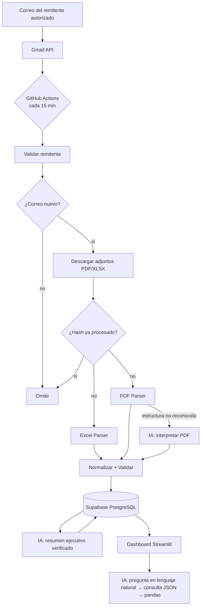

# Arquitectura

## Diagrama general

```
                ┌──────────────────────────┐
                │  Remitente autorizado    │
                │  (correo con PDF / XLSX) │
                └────────────┬─────────────┘
                             │
                             ▼
                ┌──────────────────────────┐
                │   Gmail (cuenta lectora) │
                └────────────┬─────────────┘
                             │  Gmail API · OAuth 2.0 · gmail.readonly
                             ▼
┌────────────────────────────────────────────────────────────────┐
│  GitHub Actions  (cron cada 15 min  /  ejecución manual)       │
│  python -m src.pipeline                                        │
│                                                                │
│   1. Buscar  from:<remitente> has:attachment                   │
│   2. Validar remitente exacto (encabezado From)                │
│   3. ¿Correo ya procesado? ──sí──► omitir                      │
│   4. Detectar y descargar adjuntos .pdf / .xlsx                │
│   5. ¿Archivo ya procesado? (SHA-256) ──sí──► omitir           │
│   6. Parsear                                                   │
│        ├── Excel Parser  (openpyxl)                            │
│        ├── PDF Parser    (pdfplumber: tabla o "Campo: valor")  │
│        └── IA: interpretar PDF fuera de formato (Gemini) *     │
│   7. Normalizar a estructura común                             │
│   8. Validar (reglas) + inconsistencias en el lote             │
│   9. Consolidar: INSERT ... ON CONFLICT DO NOTHING             │
│  10. IA: resumen ejecutivo (cifras verificadas)                │
│  11. Log de ejecución + alertas (anotaciones en Actions)       │
└────────────┬───────────────────────────────────────────────────┘
             │  SQLAlchemy (PostgreSQL)
             ▼
┌──────────────────────────┐        ┌───────────────────────────────┐
│  Supabase (PostgreSQL)   │◄──────►│  Dashboard Streamlit          │
│  records                 │  lee   │  (Streamlit Community Cloud)  │
│  processed_messages      │        │  KPIs · gráficos · calidad    │
│  processed_files         │        │  historial · logs             │
│  run_log · summaries     │        │  IA: pregunta en lenguaje     │
└──────────────────────────┘        │      natural → JSON → pandas  │
                                    └───────────────────────────────┘
 * solo cuando el parser determinista no reconoce la estructura
```

## Diagrama (Mermaid)



## Modelo de datos

| Tabla | Para qué sirve | Clave que evita duplicados |
|---|---|---|
| `processed_messages` | Correos ya revisados y su resultado | `message_id` (ID de Gmail) |
| `processed_files` | Historial de archivos: parser usado, registros, errores | `file_hash` (SHA-256 del contenido) |
| `records` | Registros consolidados en estructura común | `record_key` (SHA-256 de los campos normalizados) |
| `run_log` | Una fila por ejecución (logs del proceso) | — |
| `summaries` | Resúmenes ejecutivos generados | — |

### Estructura común de un registro

| Campo | Excel | PDF | Tipo |
|---|---|---|---|
| fecha | ✔ | ✔ | date |
| cliente | ✔ | ✔ | texto |
| referencia | — | ✔ | texto |
| categoria | ✔ | ✔ | texto |
| cantidad | ✔ | — | entero |
| valor | ✔ | ✔ | número |
| estado | ✔ | ✔ | texto (catálogo) |

Más metadatos: `source_type`, `file_hash`, `message_id`, `issues`, `is_complete`, `extracted_by_ai`.

## Tres niveles contra duplicados

1. **Correo:** si el `message_id` ya está en `processed_messages`, no se vuelve a descargar.
2. **Archivo:** si el mismo archivo llega en otro correo (reenvío), su hash ya existe y se omite.
3. **Registro:** si un archivo nuevo repite filas ya cargadas, `record_key` es UNIQUE y la base las ignora
   (`ON CONFLICT DO NOTHING`); se contabilizan como duplicadas en el historial.

Cada archivo y sus registros se guardan en **una sola transacción**: si algo falla a mitad, no queda
un archivo marcado como procesado sin sus registros.
